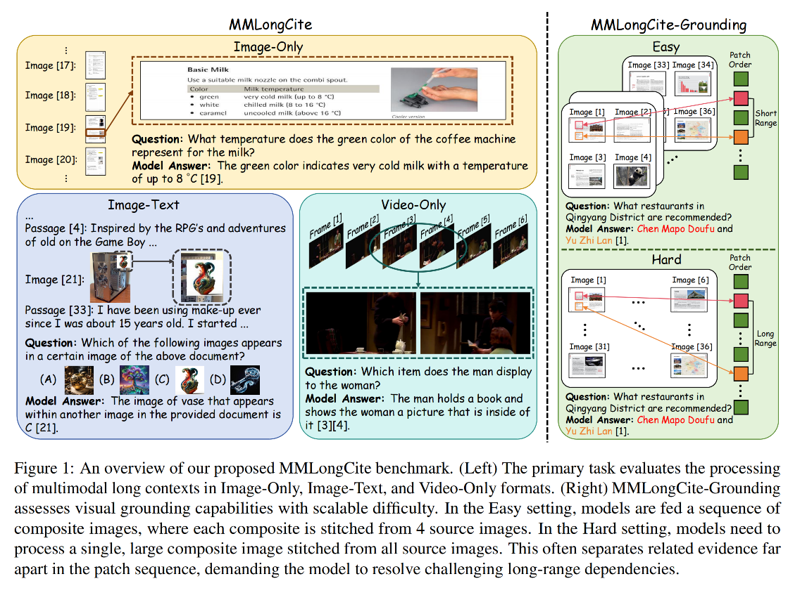
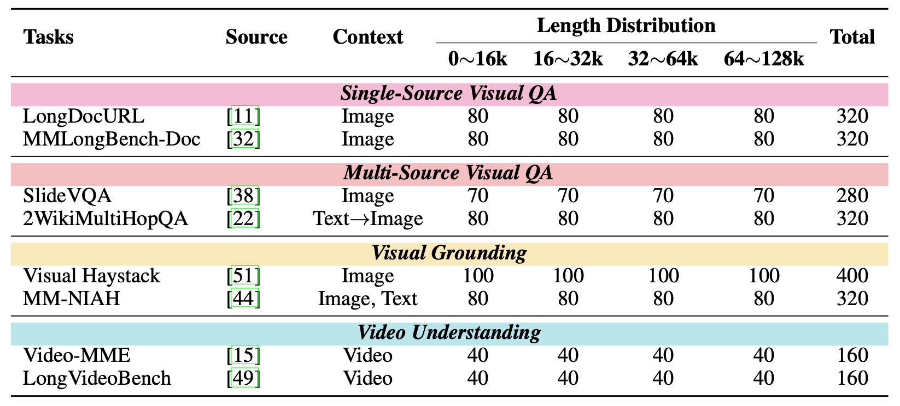

# MMLONGCITE: A Benchmark for Evaluating Faithfulness of Long-Context Vision-Language Models [NeurIPS 2026]

<p align="center">
    <a href="https://huggingface.co/datasets/Jonaszky123/MMLongCite" target="_blank" rel="noopener noreferrer">
        
    </a>
    <a href="https://arxiv.org/abs/2510.13276" target="_blank" rel="noopener noreferrer">
        
    </a>
</p>

## 📢 News

- **[September, 2026]** 🎉 MMLongCite is accepted at NeurIPS 2026.

- **[May, 2026]** Major update to MMLongCite: we extend the benchmark up to 128K tokens and refine the task taxonomy for more comprehensive faithfulness evaluation.

- **[October, 2025]** Code and data of MMLongCite are now publicly available.

## 🚀 Quick Navigation

- [🔍 Benchmark Overview](#-benchmark-overview)
- [⚙️ Preparation](#️-preparation)
    - [Environment Setup](#environment)
    - [Data Preparation](#data-prepare)
- [🤖️ Inference & Evaluation](#️-inference--evaluation)
    - [Inference](#inference)
    - [Evaluation](#evaluation)
- [📝 Citation](#-citation)
- [🏷️ License](#-license)

## 🔍 Benchmark Overview

MMLongCite is a benchmark for evaluating the **faithfulness** of long-context vision-language models (LCVLMs) through multimodal citation generation.
The benchmark contains 2,280 examples across 8 tasks, covering **image-only, image-text interleaved, and video-only** contexts. Context lengths span from **8K to 128K tokens**.
We also introduce MMLongCite-HR, a **high-resolution** setting that evaluates fine-grained visual grounding in dense stitched-image inputs. MMLongCite-HR provides two modes: the easy mode stitches 4 images into a single large image with an average resolution of 1K–2K, while the hard mode stitches 16 images into a single large image with an average resolution of 2K–4K.

<p align="center">
  
  <br>
  <em>Figure 1: Task format in MMLongCite.</em>
</p>
<p align="center">
  
  <br>
  <em>Figure 2: Statistics of tasks in MMLongCite.</em>
</p>

## ⚙️ Preparation

### Environment

Make sure you are in this project folder and then run:

```
conda activate /your/env_name 
pip install -r requirements.txt
```

### Data Prepare

You can download MMLongCite data from [🤗 Hugging face](https://huggingface.co/datasets/Jonaszky123/MMLongCite). Once downloaded, place the data in the root directory of the repository.

The folder structure is organized as follows:

```
project/
├── data/                     # Downloaded from Huggingface
│   ├── mmlongcite/           
│   └── mmlongcite-hr/ 
│       ├── easy/             
│       └── hard/             
├── images/                   # Downloaded from Huggingface
│   ├── mmlongcite/           
│   └── mmlongcite-hr/ 
│       ├── easy/             
│       └── hard/             
├── scripts/                      
│   ├── infer.sh                  
│   └── eval.sh                   
├── src/                      # Source code
├── results/                  # Benchmark inference outputs
└── readme.md                 # Documentation
```

All data in MMLongCite follows the format below: 

- id: A unique identifier for the data sample.

- context: A list containing all the contextual information (e.g., images, text) needed to answer the question.

- question: A list containing the specific question to be answered, which may include text and multiple-choice options.

- ground_truth: The correct answer for the question.

- meta: A dictionary containing additional information for each case, including:

    - text_length: The length of text content within the context.

    - mm_length: The length of multi-modal content within the context.

    - evidence_ids: A list of position identifiers indicating where the supporting evidence is located within the long context.


Here is an example:

```
{
    "id": 7,
    "context": [
        {
            "type": "image",
            "image": "image/mmlongcite/longdocurl/4120884_59.png"
        },
        ...
    ],
    "question": [
        {
            "type": "text",
            "text": "Which para title discusses non-GAAP financial measures in the document?"
        }
    ]
    "ground_truth": "Non-US. GAAP Financial Measures",
    "meta": {
      "text_length": 0,
      "mm_length": 11760,
      "evidence_ids": [
        7,
        12
      ]
    }
}
```

## 🤖️ Inference & Evaluation

### Inference

We provide a vLLM-based inference script in `src/infer_vllm.py`.
Run inference on the main MMLongCite benchmark:

```
python src/infer_vllm.py \
  --model <model_name> \
  --dataset longdocurl mmlongbench-doc slidevqa 2wikimultihopqa mm-niah visual-haystack video-mme longvideobench
```

Run inference on MMLongCite-HR:

```
python src/infer_vllm.py \
  --model <model_name> \
  --dataset longdocurl-hr-easy longdocurl-hr-hard \
            2wikimultihopqa-hr-easy 2wikimultihopqa-hr-hard \
            visual-haystack-hr-easy visual-haystack-hr-hard \
            longvideobench-hr-easy longvideobench-hr-hard
```

For models with thinking mode enabled:

```
python src/infer_vllm.py \
  --model <model_name> \
  --dataset longdocurl mmlongbench-doc slidevqa 2wikimultihopqa mm-niah visual-haystack video-mme longvideobench \
  --thinking
```

Prediction files are saved to:

```
results/<dataset>/<model_name>.json
results/<dataset>/<model_name>_thinking.json
```

You can also refer to the example script:

```
bash script/infer.sh
```

### Evaluation

MMLongCite evaluates both citation quality and answer correctness. We use GPT-5.2 as the judge model, and the evaluation scripts support passing in multiple API keys to accelerate evaluation.

**Update (October 2026):** As GPT-5.2 is no longer available via the API, we now also support Qwen3.6-27B as an open-source judge model. Evaluation results for all models, with Qwen3.6-27B as the judge, are reported in Table 8 of the paper’s appendix.

#### Citation Evaluation

```
python src/eval_cite.py \
  --model <model_name> \
  --task <dataset_name> \
  --api_keys <key1> <key2> \
  --api_base_url <api_base_url>
```

This produces:

```
results/<dataset_name>/<model_name>_citation_result.json
results/<dataset_name>/<model_name>_citation_score.json
```

#### Correctness Evaluation

```
python src/eval_correct.py \
  --model <model_name> \
  --task <dataset_name> \
  --api_keys <key1> <key2> \
  --api_base_url <api_base_url>
```

This produces:

```
results/<dataset_name>/<model_name>_correctness_result.json
results/<dataset_name>/<model_name>_correctness_score.json
```

Among the outputs, `citation_result.json` and `correctness_result.json` store per-case metrics for every example, while `citation_score.json` and `correctness_score.json` store the overall aggregated metrics for each task. Example evaluation commands are provided in:

```bash
bash script/eval.sh
```

You can run ```script/eval_with_qwen36.sh``` to use Qwen3.6-27B as the judge. 


## 📝 Citation

If you find our work helpful, please cite our paper:

```
@misc{zhou2026mmlongcitebenchmarkevaluatingfaithfulness,
      title={MMLongCite: A Benchmark for Evaluating Faithfulness of Long-Context Vision-Language Models}, 
      author={Keyan Zhou and Zecheng Tang and Lingfeng Ming and Qiguang Chen and Wangjie You and Guanghao Zhou and Dan Qiao and Zheming Yang and Libo Qin and Minghui Qiu and Juntao Li and Min Zhang},
      year={2026},
      eprint={2510.13276},
      archivePrefix={arXiv},
      primaryClass={cs.CV},
      url={https://arxiv.org/abs/2510.13276}, 
}
```

## 🏷️ License

All code within this repository is under [Apache License 2.0](https://www.apache.org/licenses/LICENSE-2.0).