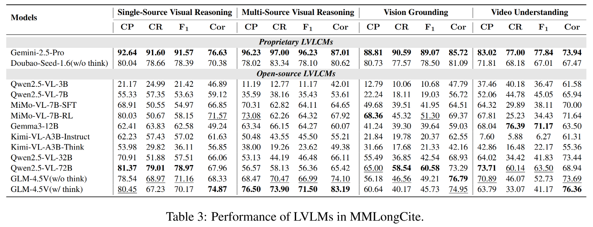
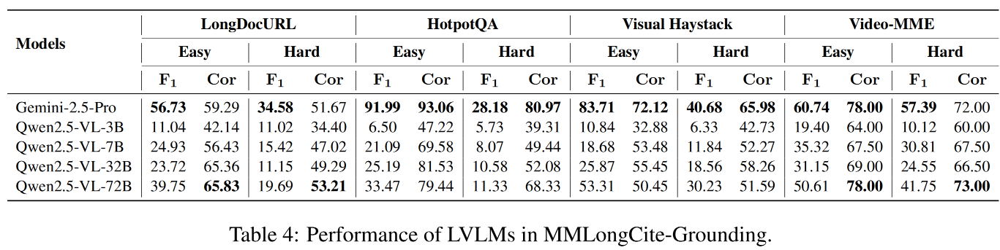

# MMLongCite: A Benchmark for Evaluating Fidelity of Long-Context Vision-Language Models

**Paper** [](https://arxiv.org/abs/2510.13276) &nbsp; **Dataset** [](https://huggingface.co/datasets/Jonaszky123/MMLongCite)

## 🚀 Quick Navigation

- [🔍 Benchmark Overview](#-benchmark-overview)
- [⚙️ Preparation](#️-preparation)
    - [Environment Setup](#environment)
    - [Data Preparation](#data-prepare)
- [🤖️ Inference & Evaluation](#️-inference--evaluation)
    - [Model Inference](#inference)
    - [Performance Evaluation](#evaluation)
- [📊 Evaluation Results](#-evaluation-results)
- [📝 Citation](#-citation)
- [🏷️ License](#-license)

## 🔍 Benchmark Overview


MMLongCite is a comprehensive benchmark designed to evaluate the **fidelity** of long-context vision-language models (LVLMs) through **citation**. It covers **4 task categories**, including Single-Source Visual Reasoning, Multi-Source Visual Reasoning, Vision Grounding, and Video Understanding, encompassing **8 distinct long-context tasks**. These tasks incorporate diverse modalities such as **images, text, and videos**, with context lengths ranging from **8K to 48K**.


## ⚙️ Preparation

### Environment

Make sure you are in this project folder and then run:

```
conda activate /your/env_name 
pip install -r requirements.txt
```

### Data Prepare

You can download MMLongCite data from [🤗 Hugging face](https://huggingface.co/datasets/Jonaszky123/MMLongCite). Once downloaded, place the data in the root directory of the repository.

The folder structure is organized as follows:

```
project/
├── MMLongCite/                   # [Download Required] Main dataset directory
│   ├── data/                     # Annotation files
│   │   ├── MMLongCite/           
│   │   └── MMLongCite-Grounding/ 
│   │       ├── easy/             
│   │       └── hard/             
│   └── images/                   # Image files directory
│       ├── MMLongCite/           
│       └── MMLongCite-Grounding/ 
│           ├── easy/             
│           └── hard/             
├── scripts/                      
│   ├── infer.sh                  
│   └── eval.sh                   
├── src/                          # Source code
└── readme.md                     # Documentation
```

All data in MMLongCite follows the format below: 

- id: A unique identifier for the data sample.

- context: A list containing all the contextual information (e.g., images, text) needed to answer the question.

- question: A list containing the specific question to be answered, which may include text and multiple-choice options.

- ground_truth: The correct answer for the question.

- task: A label that specifies the sub task category of the data sample.

- text_length: A metadata field indicating the length of text content within the context.

- mm_length: A metadata field quantifying the multi-modal content within the context(e.g., number of images).

Here is an example:

```
{
    "id": 1,
    "context": [
        {
            "type": "image",
            "image": "image/mmlongcite/longdocurl/4027862_72.png"
        },
        ...
    ],
    "question": [
        {
            "type": "text",
            "text": "What was difference value between the quantity of total consumption and total import for rice production in 2020?\n(A). 30517 metric tons\n(B). 34082 metric tons\n(C). 3565 metric tons\n(D). 64599 metric tons\nChoose the letter name in front of the right option from A, B, C, D."
        }
    ]
    "ground_truth": "C",
    "task": ["SP_Figure_Reasoning"],
    "text_length": 0,
    "mm_length": 4620,
}
```

## 🤖️ Inference & Evaluation

### Inference

We recommend using vllm to deploy the model for inference. Relevant examples can be found in the script folder.

```
### MMLongCite Inference
python src/infer_vllm.py \
        --model <your_model_name> \
        --dataset "longdocurl" "mmlongbench-doc" "mm-niah" "hotpotqa" "2wikimultihopqa" "visual-haystack" "video-mme" "longvideobench"

### MMLongCite-Grounding-Easy Inference
python src/infer_vllm.py \
        --model <your_model_name> \
        --dataset "longdocurl-grounding-easy" "hotpotqa-grounding-easy" "visual-haystack-grounding-easy" "video-mme-grounding-easy"

### MMLongCite-Grounding-Hard Inference
python src/infer_vllm.py \
        --model <Your_Model_Name> \
        --dataset "longdocurl-grounding-hard" "hotpotqa-grounding-hard" "visual-haystack-grounding-hard" "video-mme-grounding-hard"
```

Results will be saved in the ```results/``` folder. You can find a example in ```scripts/infer.sh```.

### Evaluation


```
### Evaluate Citation
python src/eval_cite.py \
    --file <Your_Inference_Result_Path> \
    --api_keys "<your_key1>" "<your_key2>" \
    --api_base_url "<your_api_base_url>"

### Evaluate Correctness
python src/eval_correct.py \
    --file <Your_Inference_Result_Path> \
    --api_keys "<your_key1>" "<your_key2>" \
    --api_base_url "<your_api_base_url>"
```

Running the evaluation code above will generate two files that record the model's final performance, with the suffixes ```"_citation_result.json"``` and ```"_correctness_result.json"``` respectively.

## 📊 Evaluation Results

Our evaluation covers commonly used long-context vision language models including both open-source and closed-source models of various sizes, architectures, and thinking modes.



We also propose MMLongCite-Grounding to specifically assess visual grounding and spatial reasoning.




## 📝 Citation

If you find our work helpful, please cite our paper:

```
@article{zhou2025mmlongcite,
  title={MMLongCite: A Benchmark for Evaluating Fidelity of Long-Context Vision-Language Models},
  author={Zhou, Keyan and Tang, Zecheng and Ming, Lingfeng and Zhou, Guanghao and Chen, Qiguang and Qiao, Dan and Yang, Zheming and Qin, Libo and Qiu, Minghui and Li, Juntao and others},
  journal={arXiv preprint arXiv:2510.13276},
  year={2025}
}
```

## 🏷️ License
All code within this repository is under [Apache License 2.0](https://www.apache.org/licenses/LICENSE-2.0).